# EC2 to ECS Fargate Migration

> A practical migration of a small Flask API from a manually managed EC2 + Nginx setup to a containerised ECS Fargate platform with Terraform, GitHub Actions, OIDC, HTTPS, observability and safer deployment/rollback paths.

## Technologies Used

### Cloud & Infrastructure

     

### Networking & Security

      

### Application & Containers

    

### CI/CD & Development

     

### Monitoring

  

### Legacy Setup

 

## Overview

This project takes a small legacy Flask API that was originally running on a single EC2 instance behind Nginx and moves it to an AWS ECS Fargate platform.

The goal was to make the app easier to deploy, monitor and recover when something goes wrong, without adding services it does not need.

### Before

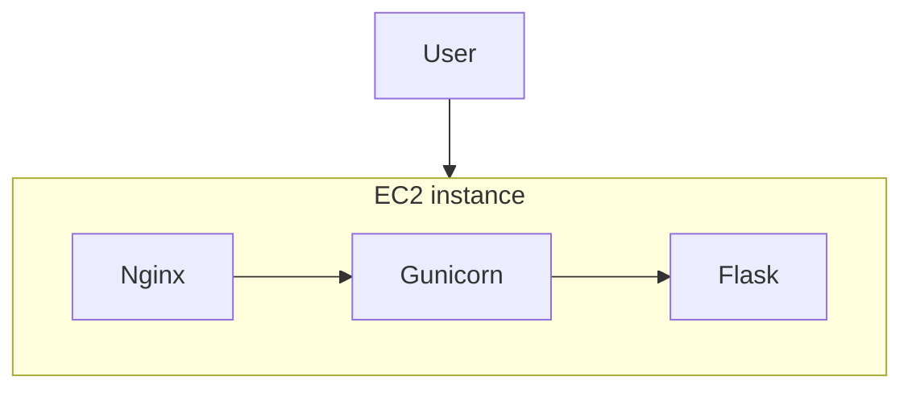

The legacy setup was simple, but deployment was manual, the application was tied to a single host, logging was inconsistent and there was no proper container or deployment lifecycle.

### After: runtime architecture

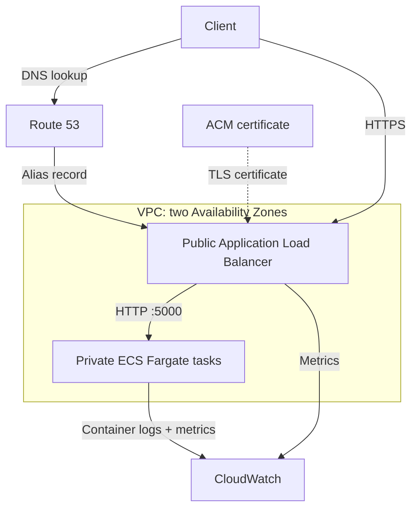

The client resolves the application hostname through Route 53, then connects to the public ALB over HTTPS. Route 53 is only responsible for DNS, while ACM provides the certificate used by the ALB. The ALB terminates HTTPS on port 443 and forwards application traffic to the ECS tasks over HTTP on port 5000. Requests to port 80 are redirected to HTTPS with a 301 response.

The ECS tasks run in private subnets with no public IPs. Each Availability Zone has its own NAT gateway for outbound traffic from the private subnets. ECS container logs are sent to CloudWatch, while ECS Container Insights and ALB metrics provide platform-level monitoring.

This is the runtime view, not a complete network diagram. NAT egress is described below; image publication, deployment and provisioning are shown separately in [CI/CD](#cicd).

## Main Engineering Decisions

| Decision | Why |
|---|---|
| ECS Fargate | Removes host management while fitting the size and operational needs of the application. |
| ALB instead of Nginx | Moves ingress into AWS and gives us managed health checks and integration with ECS. |
| Terraform | Makes the environment reproducible and reviewable. |
| GitHub OIDC | Avoids long-lived AWS credentials in GitHub. |
| SHA image tags | Makes deployments traceable and rollbackable. No `latest`. |
| Private ECS subnets | Keeps application tasks away from direct internet exposure. |
| CloudWatch | Provides the AWS-native logs, metrics and alarms required for the platform. |
| Separate Terraform role | Keeps infrastructure permissions separate from application deployment permissions. |
| Bootstrap state | Prevents the Terraform CI role and state bucket from being destroyed by the application state it manages. |
| Manual Terraform apply | Keeps infrastructure changes deliberate rather than automatically applying every merge. |
| Manual destroy workflow | Makes destructive operations explicit and adds an extra confirmation step. |
| Rollback workflow | Reduces human error when reverting to a known-good application image. |
| Route 53 + ACM | Adds a normal HTTPS entry point without introducing another proxy layer. |

## Containerisation

The application is packaged using a multi-stage Docker build and runs as a non-root user.

The image includes a container healthcheck, and the ECS task definition explicitly configures its own health check so ECS can validate application health independently of the ALB. A `.dockerignore` keeps unnecessary files out of the build context.

Images are tagged with the Git commit SHA, for example:

```text
445567089145.dkr.ecr.eu-west-2.amazonaws.com/ec2-to-ecs-migration-dev:<git-sha>
```

Using an immutable SHA instead of `latest` means an ECS task definition always points to a specific build. That makes deployments easier to trace and makes rollback safer.

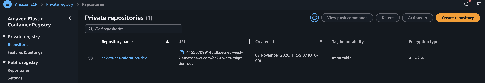

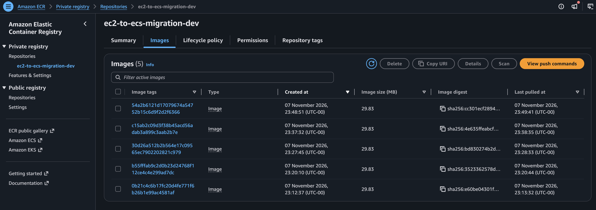

## AWS Architecture

### Networking

The VPC contains public and private subnets across multiple availability zones.

- The ALB lives in the public subnets.
- ECS Fargate tasks live in the private subnets.
- Security groups restrict traffic so application traffic reaches the tasks through the ALB.
- NAT gateways provide private-subnet egress where required.

The NAT gateways were also an important FinOps lesson. They are a meaningful recurring cost for a small development environment, so the environment should not be left running when it is not being actively tested.

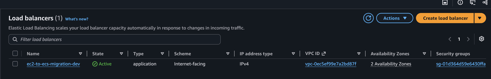

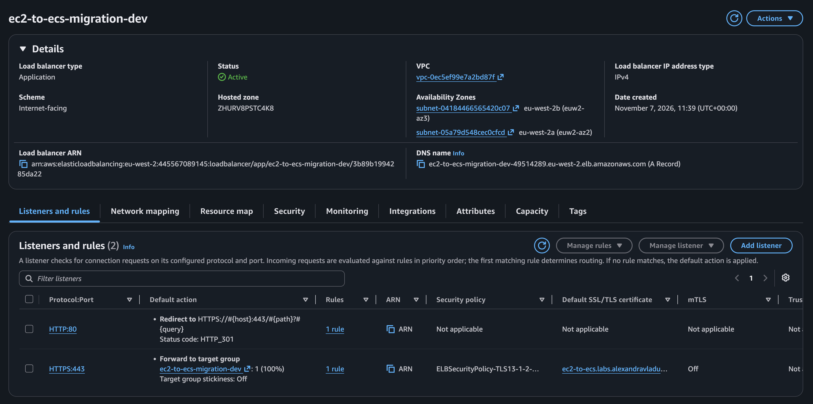

### ECS

The ECS service is configured for two Fargate tasks, with autoscaling able to adjust capacity, and registers them with the ALB target group.

The service uses:

- health checks
- deployment circuit breaker with rollback
- autoscaling policies
- ECS managed tags
- CloudWatch logging

The deployment circuit breaker provides automatic protection when a new deployment cannot become healthy, provided there is a previous completed deployment to roll back to.

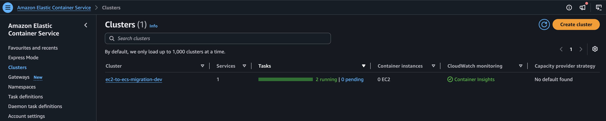

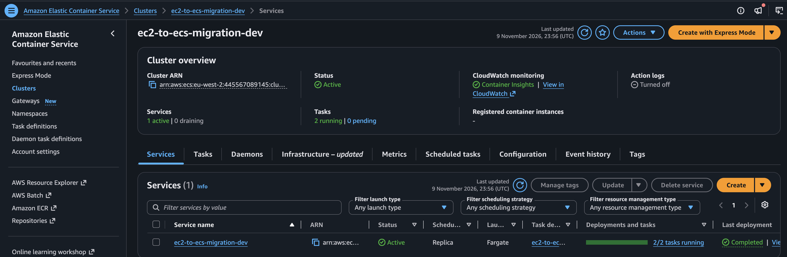

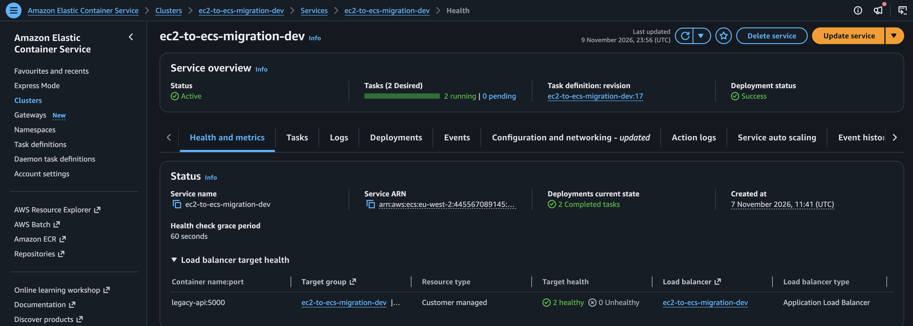

### Application limitations

The legacy API stores products, orders and stock in process memory, not in a shared database. Different tasks or worker processes can return different application state, and restarts lose changes. Two healthy tasks demonstrate infrastructure availability, not durable or consistent order processing.

This project preserves that legacy behaviour for the migration exercise. A production rollout would need a separate persistence and consistency design. See the [legacy environment assessment](docs/legacy/legacy-environment-assessment.md).

## Terraform

Terraform is split into reusable modules for the main platform, including networking, IAM, ECS, ECR, ALB, CloudWatch, autoscaling, ACM and Route 53.

There is also a separate bootstrap state for Terraform control-plane resources.

### Bootstrap vs application state

The bootstrap state owns:

- the Terraform state bucket
- the GitHub Actions Terraform role
- the Terraform role policy

The main application state owns the dev application infrastructure.

This separation is deliberate. The identity running Terraform must not be destroyed halfway through the same destroy operation that it is executing. It also means the Terraform state bucket survives application teardown.

That is cleaner than maintaining a hardcoded list of resources that the destroy workflow must avoid.

The application state uses the S3 backend; bootstrap currently uses local Terraform state. Back up the bootstrap state securely and do not commit it. Changes to the CI role or state bucket must be applied from `terraform/bootstrap` using an authorised local AWS profile.

State separation keeps these resources out of the application's destroy plan. It is not an IAM deny boundary: the Terraform role still has broad infrastructure permissions.

Terraform ignores changes to the task definition's `container_definitions` and the service's `task_definition`, leaving application revisions to CI. Consequently, editing container settings in Terraform alone does not update the deployed task; such changes need a deliberate task-definition update.

## CI/CD

There are four separate workflows, not one pipeline:

| Workflow | Trigger | Behaviour |
|---|---|---|
| [Build](.github/workflows/build.yml) | Relevant PR/push changes to `main`, or manual dispatch | Builds and scans. Only a matching push to `main` also publishes the SHA image and deploys ECS. |
| [Terraform](.github/workflows/terraform.yml) | Relevant PR/push changes, or manual dispatch | Formats/validates and plans. Only manual dispatch proceeds to apply in `production`. |
| [Rollback](.github/workflows/rollback.yml) | Manual dispatch with an existing image SHA | Validates the target and deploys that image through a new ECS task-definition revision in `production`. |
| [Terraform Destroy](.github/workflows/terraform-destroy.yml) | Manual dispatch with exact `DESTROY` confirmation | Tears down the application state in `destroy`; bootstrap resources are outside that state. |

AWS operations authenticate through GitHub OIDC: Build and Rollback use the application deployment role; Terraform and Terraform Destroy use the bootstrap-managed Terraform role. ECR stores the images that Fargate pulls when starting tasks; it is not part of the HTTP request path.

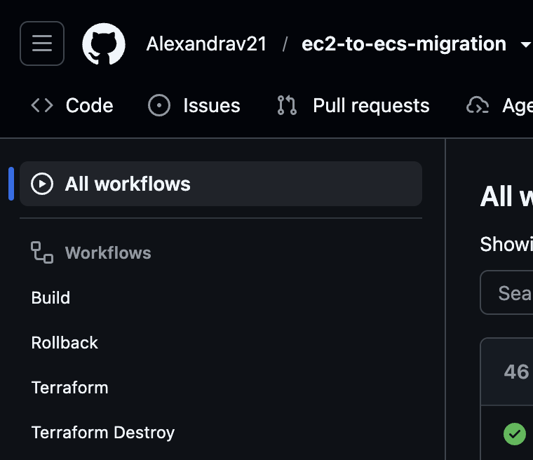

### GitHub configuration

Repository variables hold non-secret deployment settings: `AWS_REGION`, the application role's `AWS_ROLE_ARN`, `ECR_REPOSITORY`, `ECS_CLUSTER` and `ECS_SERVICE`. AWS authentication uses OIDC rather than stored access keys.

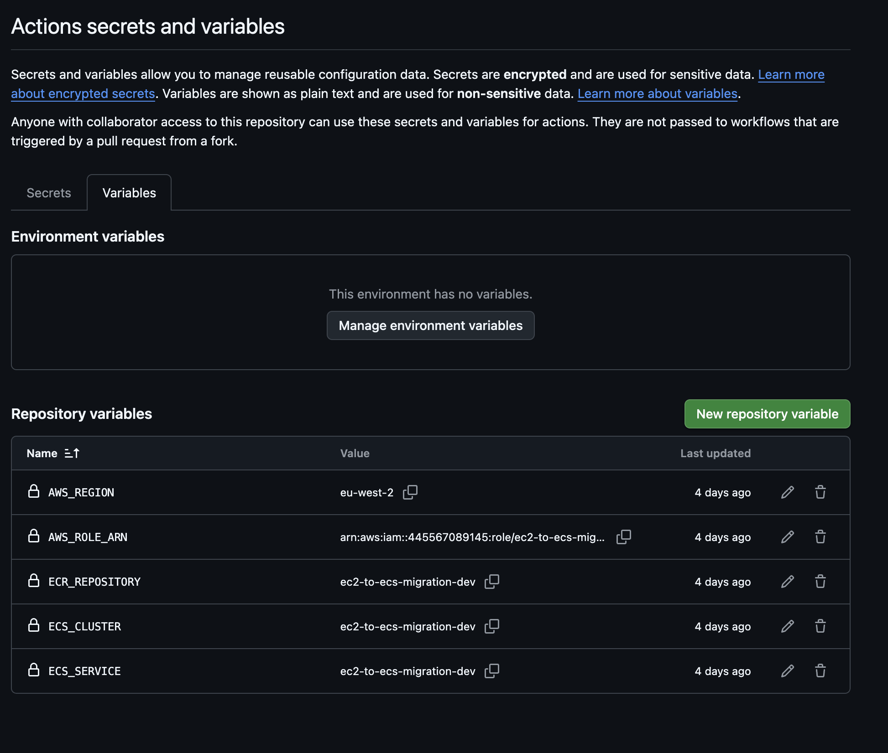

The `production` environment is used by Terraform apply and application rollback; `destroy` is used by teardown. These names organise deployments in GitHub and do not represent two separate AWS stacks. Neither environment has required reviewers configured; these operations are triggered manually.

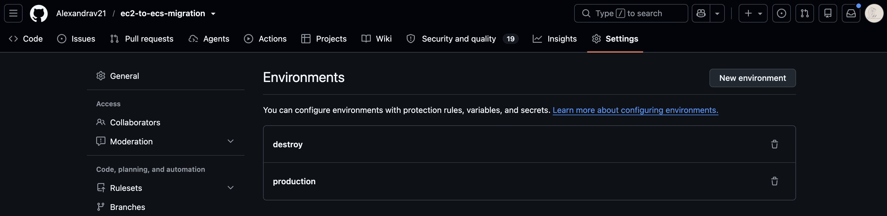

The `main` branch is protected by a repository ruleset. Changes must go through a pull request, force pushes and branch deletion are blocked, and administrators are not exempt. The required checks are `Terraform Validate` and `Terraform Plan`. Because the Terraform workflow only runs for infrastructure-related paths, a documentation-only pull request will show those checks as pending and cannot be merged until they are removed or made to report on every change.

### Application pipeline

The Build workflow handles application delivery.

Automatic runs only trigger for changes to `app/**`, `Dockerfile`, `.dockerignore` or the Build workflow itself. README, screenshot and Terraform-only commits do not rebuild or deploy the application. Manual runs remain available for build and scan checks.

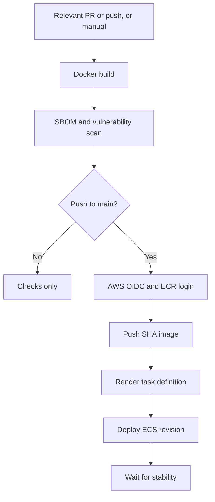

The deployment role is separate from the Terraform role.

Build, Terraform apply and Rollback share a concurrency group per Git ref. For runs on `main`, these jobs cannot overlap. This is not a global lock across branches, and the destroy workflow does not share it.

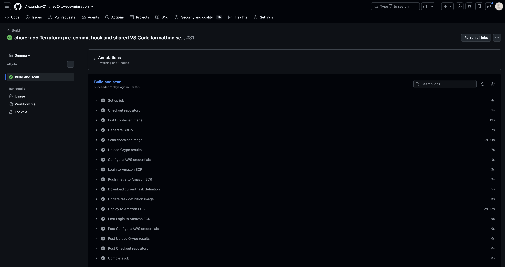

### Terraform pipeline

Terraform is deliberately treated differently from application delivery.

Pull requests and normal pushes affecting `terraform/**` or the Terraform workflow validate and plan. Terraform apply is deliberately manual.

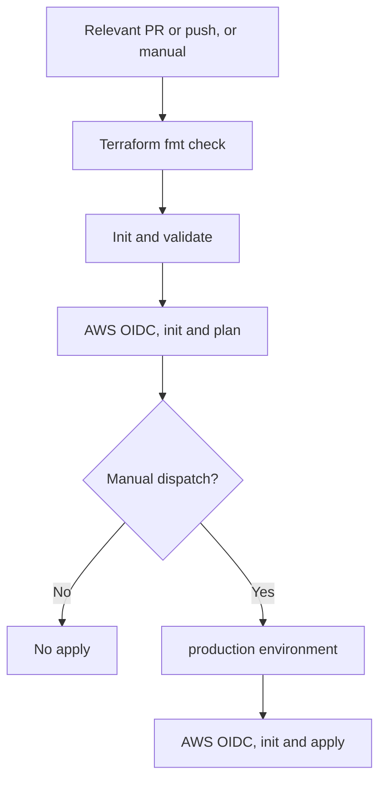

This gives us automatic feedback without making every merge an automatic infrastructure mutation.

The `production` and `destroy` environments are deployment boundaries, not configured reviewer-approval gates. Apply and destroy require manual workflow dispatch. The apply job runs its own `terraform apply`; it does not apply a saved plan artifact from the earlier plan job.

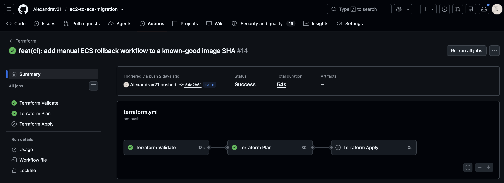

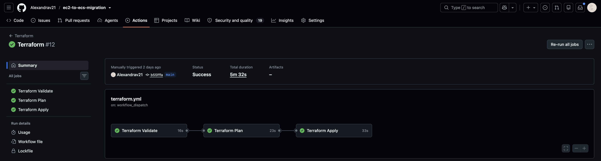

### Destroy workflow

The destroy workflow is manual-only.

It requires an explicit confirmation value of `DESTROY` before the destroy job can run, and it uses the dedicated `destroy` environment.

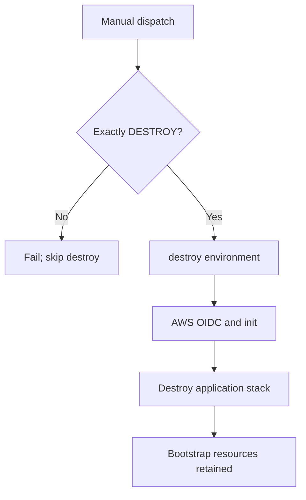

This extra friction is intentional. Destroying infrastructure should be harder to trigger accidentally than deploying an application.

I tested the guard by entering lowercase `destroy` instead of `DESTROY`. The confirmation job failed as expected, and the Terraform Destroy job was skipped. No infrastructure was destroyed.

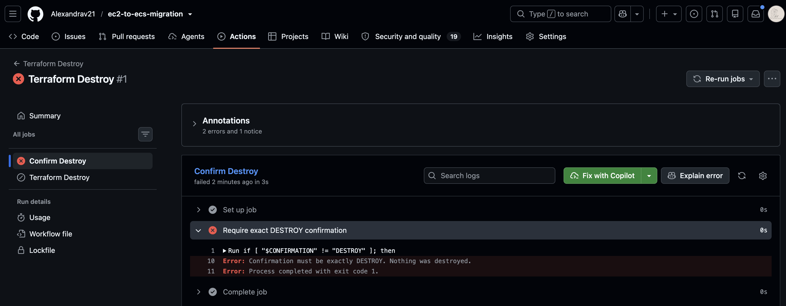

### Rollback workflow

Rollback is also manual and targets an existing immutable image SHA.

The workflow validates that the requested ECR image exists, updates the ECS task definition to that known-good image and waits for the service to become stable.

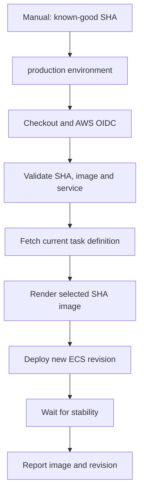

This is different from the ECS deployment circuit breaker:

- The circuit breaker handles a deployment that fails to become healthy.
- The rollback workflow handles a deployment that may be technically healthy but is functionally wrong.

A separate rollback workflow also reduces the chance of operator error compared with manually issuing several AWS commands under pressure.

## Security

Security decisions were intentionally kept practical rather than theoretical.

### GitHub OIDC

GitHub Actions uses AWS OIDC instead of storing long-lived AWS access keys.

The Terraform role and application deployment role are separate, so an application deployment does not automatically gain infrastructure administration permissions.

### IAM

The application role can push to the project ECR repository, inspect rollback images and deploy ECS task definitions using the project's task roles. The Terraform role has broader infrastructure-management permissions. Some statements are resource-scoped, while others use `Resource = "*"`, so this is not a claim of fully least-privilege IAM.

The Terraform role is kept outside the application state so it survives application destruction.

### Container security

The container runs as a non-root user and images are scanned during CI. An SBOM is generated as part of the build.

Grype findings are uploaded to GitHub code scanning, but `fail-build: false` means vulnerability findings do not block deployment. A green build therefore does not mean the image has no vulnerabilities.

## HTTPS: Route 53 + ACM

The project reuses the existing hosted zone and adds an application hostname:

```text
https://ec2-to-ecs.labs.alexandravladu.co.uk
```

Terraform manages:

- the ACM public certificate
- DNS validation records
- the ALB HTTPS listener
- the Route 53 alias record
- HTTP to HTTPS redirect

The hosted zone itself is looked up rather than owned by this application state. That means destroying this project removes the application-specific records and certificate without destroying the shared hosted zone.

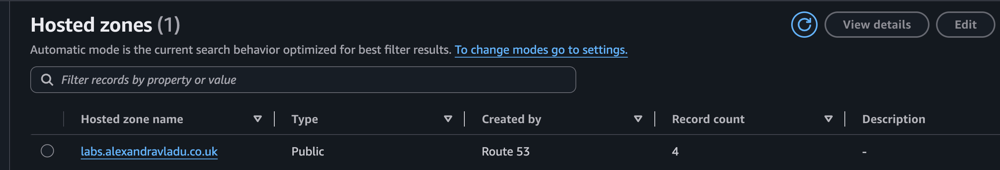

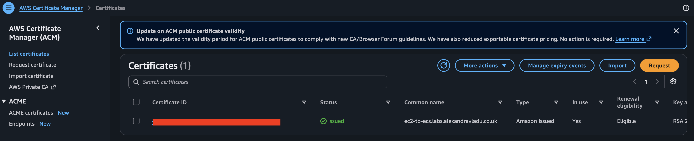

## Observability

CloudWatch is the primary observability layer.

### Logs

ECS task logs are sent to:

```text
/ecs/ec2-to-ecs-migration-dev
```

Logs have a 14-day retention period. ECS Container Insights is also enabled for task/container-level telemetry.

### Metrics and alarms

The [CloudWatch module](terraform/modules/cloudwatch/main.tf) defines four alarms:

| Alarm | Metric | Configured threshold |
|---|---|---|
| High ECS CPU | `CPUUtilization` | Above 80% for two consecutive 5-minute periods |
| Load balancer 5xx | `HTTPCode_ELB_5XX_Count` | More than 5 in 5 minutes |
| Application 5xx | `HTTPCode_Target_5XX_Count` | More than 5 in 5 minutes |
| Application latency | `TargetResponseTime`, p95 | Above 1 second for two consecutive 5-minute periods |

Load balancer errors and application errors are distinct signals. All four alarms treat missing data as non-breaching. They expose alarm state in CloudWatch but have no notification actions configured, so an `OK` state alone is not proof of traffic or end-to-end health.

The ECS deployment circuit breaker also provides deployment-level protection.

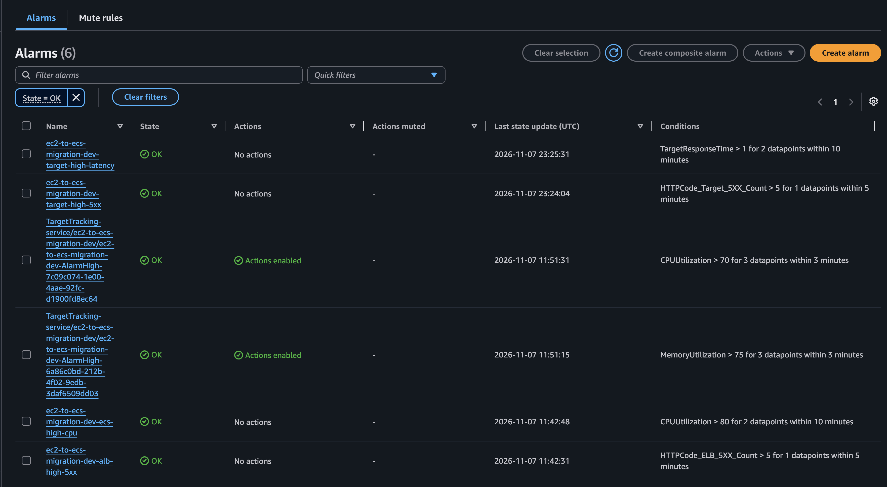

### Why not New Relic?

I considered New Relic, but decided to keep CloudWatch for this project. New Relic could give me more detail about individual requests, but it would also mean another account, agent and secret to manage.

For a small, short-lived app, I would rather fix the gaps in the monitoring I already have. That is why I added the application 5xx and latency alarms instead.

## Cost and FinOps

Keeping AWS resources running solely to maintain a live portfolio link would create unnecessary ongoing costs.

NAT gateways, Fargate tasks and the ALB incur charges while running. NAT gateways are especially worth watching in a small project like this, where the environment is only needed for testing and screenshots.

My plan is simple:

```text
Deploy
  -> validate
  -> capture evidence
  -> destroy when finished
```

That is why I added a destroy workflow rather than leaving cleanup as a list of manual AWS commands.

I also kept CloudFront, WAF, Redis, multi-region infrastructure, Vault, CodeDeploy blue/green and New Relic out of scope. They can be useful elsewhere, but I did not need them to demonstrate this migration.

I wanted to be able to explain why each part is there, rather than keep adding services just because I could.

## Cutover Strategy

Cutover just means switching users from the old EC2 app to the new ECS app.

**I have not switched live production traffic for this project.** I tested ECS through its own hostname. If this were a real migration, this is how I would approach the switch:

1. **Keep EC2 running while I test ECS.** I would not shut down the working app before checking its replacement.
2. **Check the new app, not just the pipeline.** Both ECS tasks should be healthy, the ALB should be able to reach them, HTTPS should work and `/health` should return 200. I would also test the product and order endpoints, because a green health check does not prove everything works.
3. **Check the logs and monitoring.** Make sure requests appear in the logs and look for errors, slow responses or unhealthy tasks. An alarm showing `OK` is useful, but not enough on its own.
4. **Point the real application hostname at the ECS ALB in Route 53.** Save the old DNS settings first so I can put them back if needed.
5. **Watch what happens after the switch.** Keep checking requests, errors, response times and task health. Some users may still reach EC2 for a while because their DNS lookup is cached.
6. **Only remove EC2 once I am happy the new setup is working.** Keeping it available gives me a way back while I check the migration.

For DNS records with an adjustable TTL (how long a lookup can be cached), I would lower it ahead of the switch. Route 53 aliases to an ALB use AWS's target TTL instead, so that is not something I can set myself.

**The important limitation here is the app's data.** Orders and stock are held in memory. Changing DNS does not move that data, and EC2 and ECS could end up with different orders if both accept writes. Before a real switch, I would need a way to preserve the data and decide how to pause or coordinate new orders. The steps above are not a complete production migration plan without that.

### If something goes wrong

There are two different things I might need to undo:

- **The traffic switch:** restore the previous DNS record so users go back to EC2 while I investigate. This is not instant because of DNS caching, and it does not copy back any orders created on ECS.
- **An application release:** if the ECS setup is fine but the new app version has a bug, use the Rollback workflow to deploy an older image that I know worked.

The rollback workflow changes the app image. It does not undo infrastructure changes or recover lost data.

## Validation

A green Terraform apply is not the finish line. I also need to check that the deployed app actually works.

For the screenshots, I will include the workflow run or commit SHA and the date where possible. That makes it clear which version I checked, especially once the environment has been deleted.

Validation included:

- Docker image builds
- SBOM generation
- vulnerability scanning
- ECR image verification
- ECS service health
- two running Fargate tasks
- ALB target health
- application `/health` response
- immutable SHA image running in ECS
- CloudWatch logs
- CloudWatch alarms
- Terraform plan and apply
- HTTPS through Route 53 and ACM
- HTTP to HTTPS redirect
- Terraform destroy planning and control-plane state separation

So far, the rollback checks have been tested with read-only AWS calls and invalid inputs, and destroy has been previewed with a Terraform plan. That is not the same as actually rolling back a deployment or deleting the environment. I will record those separately if I run them.

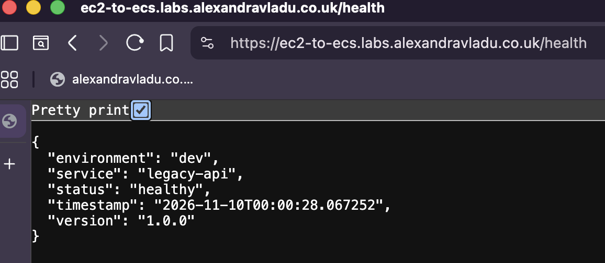

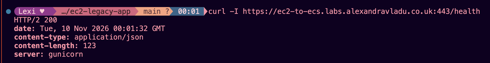

## Operational Runbook

### Deploy the application

Push an application, image-build or Build workflow change to `main` after the normal review/check process. GitHub Actions builds, scans and publishes the SHA-tagged image, then deploys the ECS task definition and waits for service stability. Documentation-only pushes do not deploy.

### Change infrastructure

Open a pull request and review the Terraform plan. After merge, Terraform plan runs again. Apply is performed deliberately through the Terraform workflow rather than automatically on every merge.

### Roll back the application

Use [Rollback](.github/workflows/rollback.yml) for a deliberate rollback when a release passes health checks but is functionally wrong. It reuses an existing image rather than rebuilding, scanning or pushing it. ECS's deployment circuit breaker remains the automatic protection for deployments that fail to become healthy.

#### Choose a known-good image

1. Find a successful Build run whose application behaviour was verified, and copy its full 40-character commit SHA. A green run alone does not prove functional correctness.
2. Confirm that image is still in ECR. The lifecycle policy expires images beyond the five most recent, so an old successful release may no longer be available.

   ```bash
   aws ecr describe-images \
     --region eu-west-2 \
     --repository-name ec2-to-ecs-migration-dev \
     --query 'sort_by(imageDetails,&imagePushedAt)[].[imageTags[0],imagePushedAt]' \
     --output table
   ```

   Use an authorised AWS profile, or inspect the repository in the ECR console.

#### Run and verify

Go to **Actions → Rollback → Run workflow**, select `main`, and enter the full SHA. The job uses the `production` environment and the same deployment concurrency group as Build and Terraform apply.

Before any ECS change, [scripts/rollback-checks.sh](scripts/rollback-checks.sh) checks:

- the workflow is running from `main`
- the target is exactly 40 lowercase hexadecimal characters, not empty, shortened or `latest`
- the tag exists in the configured ECR repository
- the configured ECS service is active in the specified cluster
- the AWS reads succeed

It downloads the service's currently assigned task definition, changes only the application image through the render action, then registers and deploys a new revision and waits for stability. This is an **image rollback**, not restoration of the old revision's environment variables, secrets or other configuration.

The run summary reports the selected image and digest, new task-definition ARN and previous image. Check the service's actual deployed revision and test the affected endpoints afterwards, including `/health`; service stability alone does not prove functional recovery.

Revert or fix the bad commit before the next deployment-triggering push to `main`, because the normal Build workflow deploys the image built from that new commit.

### Destroy the dev environment

Use the Terraform Destroy workflow manually. Enter `DESTROY` exactly when prompted. The workflow then performs the teardown against the application state while leaving the bootstrap control plane and Terraform state bucket intact.

Capture evidence first, and do not start teardown while builds, rollbacks or Terraform applies are running. ECR uses `force_delete = true`, so teardown deletes retained images as well as the repository. The shared hosted zone, bootstrap bucket and Terraform CI role remain; review those separately if the goal is complete account cleanup.

### Local formatting and pre-commit checks

After cloning, enable the repository hook:

```bash
git config core.hooksPath .githooks
git hook run pre-commit
```

The hook checks Terraform formatting recursively and validates both application and bootstrap configurations. Initialise both configurations first; normal application backend initialisation requires AWS credentials. Shared VS Code settings recommend the HashiCorp Terraform and Red Hat YAML extensions and enable formatting on save.

## Final Takeaway

For me, this project was about more than getting a container to run on ECS.

I wanted to understand how the pieces fit together, why a pipeline failed, how to check what was actually deployed and how to get back to a working version without guessing under pressure.

The app now has repeatable deployments, HTTPS, logs and alarms, plus manual workflows for infrastructure changes, rollback and cleanup. The platform is production-minded, but the application still has known limitations, especially around in-memory state. Those limitations would need to be addressed before a real production migration.
